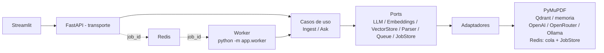

# Sistema RAG Multimodal

> **Demo en vivo:** https://rag.xorbit360.com — Trabajos: https://rag.xorbit360.com/Trabajos

Sistema RAG para PDFs técnicos con texto, tablas, diagramas e imágenes.
Responde en lenguaje natural usando solo el contexto recuperado, muestra
la fuente con página y, cuando la respuesta usa un diagrama, muestra la
imagen más cercana.

> **Documento de ejemplo:** `examples/Manual_Motor.pdf` es un manual
> inventado para la prueba. No es un manual real de ningún fabricante.

## Cumplimiento del enunciado, punto por punto

Texto del PDF: "Prueba Técnica: Sistema RAG Multimodal",
perfil Ingeniero de Software (Integración IA), duración sugerida
48 horas, expectativa clave: "No buscamos un simple script lineal
de Python. Esperamos una solución estructurada que demuestre cómo
se integra la Inteligencia Artificial dentro de una arquitectura de
software lista para despliegue en producción."

| Sección del PDF | Qué pide, tal cual | Dónde se cumple, con evidencia |
|---|---|---|
| 1. Arquitectura y Diseño | Arquitectura limpia (Hexagonal o por Capas); separar transporte, lógica de negocio e integraciones; Inyección de Dependencias para cambiar LLM o base vectorial sin tocar el core; variables de entorno (.env) y configuración por ambiente | `app/main.py` (solo transporte), `app/domain/` (casos de uso), `app/adapters/` (proveedores), `app/dependencies.py` (wiring por .env), `app/config.py` (pydantic-settings). Cambiar OpenAI por Ollama es solo `OPENAI_BASE_URL` / modelo. |
| 2. Procesamiento Asíncrono | Procesamiento en segundo plano, no bloquear el hilo principal; `job_id` al subir y endpoint de progreso Pending / Processing / Completed / Failed; extracción multimodal (texto, tablas, imágenes); bounding boxes para correlacionar texto y contexto visual | `POST /ingest` devuelve `job_id` al instante, `GET /jobs/<job_id>` da el estado, `app/worker.py` consume de Redis y re-ejecuta la ingesta, `app/adapters/pdf_parser.py` guarda bbox por bloque e imagen. |
| 3. Motor RAG | Chunking por semántica o layout, no solo por caracteres; base de datos vectorial; recuperación híbrida (semántica + palabras clave); detectar imágenes asociadas a los chunks; generación defensiva, admitir explícitamente cuando no hay información suficiente | `app/adapters/chunking.py` (por layout, tablas como chunk propio), Qdrant (`VECTOR_STORE=qdrant`), `app/domain/retrieval.py` (híbrida, umbral 0.15), imagen más cercana por bbox, prompt defensivo con la frase exacta de negativa. |
| 4. Pruebas y Resiliencia | Pruebas unitarias aislando terceros, con mocks para LLM y base vectorial; retries / Circuit Breaker para caídas, rate limits y timeouts; logging con trazabilidad | `tests/` con mocks, `app/infrastructure/resilience.py` (retry con backoff + jitter, circuit breaker 3 fallos → 30 s), logging con `job_id` / `question_id`. |
| 5. Interfaz y Experiencia | Chat interactivo con historial y Markdown; imagen más cercana junto a la respuesta cuando depende de un diagrama; metadatos explícitos "Fuente: Manual_Motor.pdf, Página 12" | `frontend/app.py` (Streamlit): chat, historial, Markdown, imagen junto a la respuesta, fuente con documento y página. El menu aparte `frontend/pages/2_Trabajos.py` muestra los trabajos de Redis en solo lectura, sin contaminar la visual del chat. |
| Entregables: Repositorio | Código versionado en GitHub o GitLab, con commits semánticos e historial lógico | Este repositorio, rama main, commits semánticos. |
| Entregables: Entorno Contenerizado | `docker-compose.yml` funcional que orqueste API, frontend y servicios auxiliares con un solo comando | `docker compose up --build`: api + worker + frontend + Qdrant + Redis. |
| Entregables: README | Diagrama de arquitectura, registro de decisiones, instrucciones para arrancar y ejecutar tests | Este README: diagrama abajo, sección Decisiones, Arranque y Tests. |
| Entregables: Demostración | Un breve video (Loom/YouTube) **o** un despliegue en la nube probando el sistema con un documento técnico de ejemplo | Despliegue en nube (esta opción del enunciado, no video): demo pública con el manual de ejemplo precargado, sin instalar nada. |

Nada de lo anterior se presenta como hecho si no lo está: los
límites que quedan se declaran en su sección, no se esconden.

## Arranque con un solo comando

```bash
cp .env.example .env   # opcional; sin llave, corre en modo demo sin costo
docker compose up --build
```

- API: http://localhost:8000 — docs en http://localhost:8000/docs
- Frontend: http://localhost:8501
- Qdrant: http://localhost:6333

Sin Docker, en local:

```bash
python -m venv .venv && source .venv/bin/activate
pip install -r requirements.txt
uvicorn app.main:app --reload          # API en :8000
streamlit run frontend/app.py          # UI en :8501
```

## Uso de la API

```bash
# 1. Ingerir (responde al instante con job_id, no bloquea)
curl -F "file=@examples/Manual_Motor.pdf" http://localhost:8000/ingest
# {"job_id": "...", "status": "pending", ...}

# 2. Consultar el progreso
curl http://localhost:8000/jobs/<job_id>
# status: pending | processing | completed | failed

# 3. Preguntar
curl -X POST http://localhost:8000/ask \
  -H "Content-Type: application/json" \
  -d '{"question": "¿Cuál es el par de apriete de los tornillos de culata?"}'
# {"answer": "... 24 Nm ...",
#  "sources": [{"document_name": "Manual_Motor.pdf", "page": 4, "kind": "table"}],
#  "image_url": "/images/<id>"}
```

Pregunta fuera de contexto → respuesta explícita, sin fuentes inventadas:

> "No tengo información suficiente en los documentos para responder eso."

## Manual de ejemplo precargado (seed)

Al arrancar la API, si `demo_mode` es `True` y el vector store está
vacío, se ingiere automáticamente `examples/Manual_Motor.pdf` con el
mismo pipeline de la subida por UI (parser, chunking, embeddings,
store, imágenes), de forma síncrona y sin pasar por la cola. Así el
demo responde desde el primer momento sin que el visitante tenga que
subir nada, y preguntar sin documentos ya no produce un error crudo:

- Si el store ya tiene chunks, el seed no hace nada (no duplica).
- Si el seed falla (store caído, PDF ausente, error de ingesta), solo
  queda un warning en el log: el arranque nunca se tumba.
- Fuera de modo demo, el seed no corre.
- El hash del manual queda registrado: si después se sube el mismo PDF
  por UI, se detecta como duplicado y no se reindexa.

Si Qdrant no responde, `/ask` (y `/ask-audio`, `/ask-image`) devuelven
un 503 limpio en español en vez de un 500. Una colección inexistente
no es un error: significa "sin documentos" y la búsqueda devuelve
vacío, para que el caso de uso responda la negativa defensiva.

## Contenido del manual de ejemplo

`examples/Manual_Motor.pdf` tiene 12 páginas, 18 chunks (13 de texto y
5 de tabla) y 4 imágenes embebidas que el parser extrae con página y
bbox: vista explotada (pág. 3), circuito de refrigeración (pág. 6),
circuito de lubricación (pág. 7) y esquema eléctrico (pág. 8).
Secciones: introducción, especificaciones técnicas, componentes,
pares de apriete, plan de mantenimiento, refrigeración, lubricación,
sistema eléctrico, cambio de aceite, diagnóstico de fallas, seguridad
y registro/glosario. Datos clave verificados tras la ingesta: par de
culata **24 Nm (pág. 4, tabla)**, potencia 12 kW (pág. 2), termostato
82 °C (pág. 6), presión de aceite 2,5–4,0 bar (pág. 7).

Regenerar el PDF (y sus 4 diagramas PNG) después de editar el
generador:

```bash
python examples/generate_manual.py
```

## Arquitectura (hexagonal)



| Capa | Contenido |
|---|---|
| Transporte | `app/main.py` (FastAPI, solo HTTP) |
| Dominio | `app/domain/` — modelos, ports, chunking lógico, retrieval, casos de uso |
| Adaptadores | `app/adapters/` — PyMuPDF, embeddings, LLM, Qdrant/memoria, colas |
| Infraestructura | `app/infrastructure/` — retry, circuit breaker, logging |

El core no importa FastAPI, Streamlit ni ningún proveedor. Los casos de
uso solo conocen los `Protocol` de `app/domain/ports.py`.

## Decisiones técnicas

### Chunking por layout, no por caracteres
Se corta por sección (un encabezado abre sección nueva), las tablas son
un chunk propio (nunca se parten por la mitad) y dentro de una sección
larga se parte por párrafos con 120 caracteres de solapamiento. Cada
chunk guarda documento, página, bounding box y sección. Un corte solo por
caracteres rompería tablas y mezclaría secciones distintas, que es justo
lo que un manual técnico no permite.

### Multimodal con bounding boxes
PyMuPDF extrae texto con su rectángulo real, tablas con `find_tables`
(pdfplumber como respaldo) e imágenes raster con página y rectángulo.
Cada chunk de texto se asocia a la imagen más cercana en la misma página
(distancia entre centros de bbox). La UI muestra esa imagen junto a la
respuesta, no una imagen cualquiera del documento.

### Por qué PyMuPDF
PyMuPDF (fitz) da en una sola pasada texto con su rectángulo real,
tablas con `find_tables` e imágenes con página y rectángulo. Las
alternativas no dan eso junto: pypdf extrae texto pero sin layout ni
bounding boxes fiables, y pdfplumber da buenas tablas pero es más
lento y su modelo de layout es más limitado para diagramas. Por eso
pdfplumber queda solo como respaldo si PyMuPDF falla en un PDF. Sin
bounding boxes reales no habría chunking por layout ni "imagen más
cercana" fiable: esa es la base de lo multimodal.

### Recuperación híbrida
Semántica (coseno sobre embeddings) + BM25 implementado en el proyecto
(sin servicio externo). El puntaje final usa el coseno **crudo**, no
normalizado: si se normalizara, el mejor chunk siempre tendría 1.0
aunque la pregunta fuera totalmente ajena, y el umbral de relevancia
nunca rechazaría nada. El BM25 sí se normaliza porque su escala depende
del tamaño del corpus. Umbral de relevancia: 0.15; por debajo, negativa
explícita. Tanto BM25 como el embedding hash ignoran palabras vacías en
español ("de", "es", "la"...): sin eso, cualquier pregunta compartía
esos tokens con cualquier chunk y pasaba el umbral.

### Generación defensiva
Prompt de sistema con temperatura 0.0 que obliga a responder solo con el
contexto y a devolver la frase exacta de negativa si no alcanza. Nunca
se inventa fuente ni página: las fuentes salen de los chunks recuperados.

### Por qué Qdrant
Qdrant es el vectorial externo en producción (persistente, filtrable,
con API HTTP). En tests y demo se usa el adaptador en memoria con la
misma interfaz, para que los tests no necesiten Docker ni red. Cambiar
es `VECTOR_STORE=qdrant` en `.env`.

### Por qué Streamlit
Es el cliente más rápido de verificar para esta prueba (chat, Markdown,
imágenes, subida de PDF) sin un build de frontend. La API es
independiente: un cliente React/Next.js puede reemplazarlo sin tocar el
core.

### Cambiar de proveedor LLM
El adaptador es OpenAI-compatible (`/chat/completions`). Cambiar es
solo `.env`, sin tocar código:

| Proveedor | `OPENAI_BASE_URL` | Nota |
|---|---|---|
| OpenAI | `https://api.openai.com/v1` | `OPENAI_MODEL=gpt-4o-mini` |
| OpenRouter | `https://openrouter.ai/api/v1` | modelo OpenRouter, misma API |
| Ollama local | `http://localhost:11434/v1` | modelo local, sin costo por token |

Sin llave, o con `DEMO_MODE=true`, entra `FakeLLM`: respuesta
extractiva desde los chunks, sin llamar a ninguna API de pago. Es el
modo usado en tests y en la demo local.

### Tu propio token desde la web (opcional)
En la barra lateral, pega tu token y pulsa "Detectar proveedor": la API
lo prueba contra OpenAI y OpenRouter (en OpenRouter la validez se
comprueba con /auth/key porque /models es publico) y te muestra el
proveedor y sus modelos para elegir. Un token solo no dice que modelo
es: el modelo se lista desde el proveedor y lo eliges tu. Tambien hay
configuracion manual (proveedor + base_url + modelo) para cualquier
endpoint compatible con OpenAI, incluido Ollama local. Sin token propio
ni predeterminado, sigue el modo demo sin costo. La clave viaja solo
del navegador al frontend por TLS y de ahi a la API por la red interna
de Docker (la API no se publica); nunca queda en logs ni en Git.

### Endpoint propio sin token (Ollama local)
Ollama no exige clave: en la barra lateral escribe solo la "Base URL
personalizada" (p. ej. `http://localhost:11434/v1`) y la API detecta
automaticamente sus modelos desde /models, sin token. Si la URL esta
presente, manda sobre el token y el token guardado, y el chat usa ese
endpoint aunque no haya clave (una clave vacia ya no cae a la boveda
ni al modo demo). Si la URL no lista modelos, escribe el modelo a mano.
Limite honesto de alcance: las llamadas al LLM las hace el servidor,
no tu navegador, asi que un Ollama "local" solo es alcanzable cuando
el stack corre en la misma maquina que Ollama (en docker-compose, la
api ve al host como `http://host.docker.internal:11434/v1`); desde el
demo publico no se puede alcanzar el localhost del visitante. El audio
sigue exigiendo un proveedor con transcripcion (whisper): un modelo de
chat de Ollama no transcribe. La pregunta con imagen si funciona con
un modelo de vision de Ollama (p. ej. llava) desde un endpoint propio,
con o sin token.

### Token guardado en el servidor, encriptado (opcional)
Si pulsas "Guardar token en el servidor", el backend cifra tu token
(Fernet simetrico) y lo asocia a un identificador aleatorio de tu
navegador (el demo no tiene login). El navegador guarda solo ese
identificador, nunca el token. Al volver, el frontend recupera el
estado (proveedor, modelos) y las preguntas resuelven la clave en el
servidor, sin volver a pegarla. "Borrar mi token guardado" elimina tu
token y vuelve al predeterminado (si lo hay) o al modo demo. Si el
servidor no tiene configurada la clave de cifrado
(TOKEN_ENCRYPTION_KEY), guardar falla con un mensaje claro: nunca se
guarda nada en plano. Nota honesta: el cifrado protege los datos
guardados, no un servidor comprometido, porque el servidor debe
desencriptar para llamar al proveedor.

### Token predeterminado compartido (lo pone el dueno en el servidor)
El servidor puede tener UN token predeterminado que usa cualquier
visitante sin token propio guardado; si el visitante guarda el suyo,
usa el suyo. La UI indica cual esta activo ("tu token guardado",
"token predeterminado del demo" o "modo demo") sin revelar jamas el
valor. La predeterminada NO se puede poner ni borrar desde la web
publica: solo el dueno, en el servidor, con el script:

    TOKEN_ENCRYPTION_KEY=<clave> python3 scripts/set_default_token.py \
        [--provider openai] [--model MODELO]

El script pide el token con getpass (no se muestra, no queda en el
historial ni en argumentos) y lo deja cifrado en
storage/default_token.enc (dentro del volumen persistente, asi que
sobrevive a reconstrucciones). El modelo por defecto es gpt-4o-mini;
con --model vacio queda automatico (que exige lista de modelos en la
peticion, como siempre). Dentro del contenedor de la API:

    docker compose exec -e TOKEN_ENCRYPTION_KEY=<clave> api \
        python scripts/set_default_token.py

Generar la clave de cifrado (una vez, en el entorno del servidor,
nunca en Git):

    python -c "from cryptography.fernet import Fernet; print(Fernet.generate_key().decode())"

Ojo: el predeterminado compartido cobra a la clave del dueno cada
pregunta, audio e imagen de cualquier visitante. Si se abusa de el,
hay que rotarlo (volver a correr el script con la clave nueva).

### Modelo automatico: el mas economico (predeterminado)
Tras detectar el proveedor, la opcion predeterminada es "Automatico (el
mas economico)". Al preguntar, el backend elige segun lo que requiera
la pregunta: con imagen, el mas economico con vision; con audio, el
modelo de transcripcion; con solo texto, el chat mas economico. Para
elegir usa los precios que el proveedor devuelve en /models (OpenRouter
los trae) y, si no hay precios, una tabla de orden de costo conocido
(mini/flash primero) con fallback al orden del proveedor. Cada respuesta
muestra el modelo usado ("Modelo usado: gpt-4o-mini (automático)"). Si
eliges un modelo manual, se respeta tu eleccion. El automatico solo
elige modelos de chat: excluye whisper, tts, embeddings, imagen y
realtime, y en empate gana el modelo base exacto antes que sus
variantes. Sin ese filtro, una variante no-chat podia ganar por
compartir subcadena ("gpt-4o-mini-tts") y el chat devolvia 404
despues de una transcripcion exitosa, con un mensaje que culpaba a
la transcripcion (caso real 2026-11-04).

### Borrar un documento
Desde el chat (lista de documentos indexados) y desde `Trabajos` se
puede eliminar un PDF, con confirmacion en dos pasos. `DELETE
/documents/{document_id}` borra sus puntos en el vector store, sus
trabajos en el JobStore, su indice de hash y sus archivos (PDF e
imagenes). Borra por document_id, no por nombre: dos ingestas del
mismo nombre se borran una por una. Tras borrar, el mismo PDF se
puede volver a subir sin aparecer como duplicado.

### Preguntas por audio e imagen (chat, con token)
El chat acepta adjuntos (el PDF NO: sigue solo por la barra lateral):
- **Audio** (subido o grabado en el chat): `POST /ask-audio` lo
  transcribe con el endpoint /audio/transcriptions del proveedor de tu
  token (whisper-1 por defecto) y luego pregunta al RAG con el texto.
  La respuesta devuelve transcripcion + respuesta + fuentes. Sin token,
  la web avisa que el audio lo necesita y no se inventa ninguna
  transcripcion.
- **Imagen**: `POST /ask-image` la describe con el modelo de vision del
  proveedor (chat completions con image_url) y con esa descripcion busca
  en el RAG a que hace referencia. La respuesta devuelve descripcion +
  respuesta + fuentes + la imagen almacenada mas cercana. La imagen
  enviada NO se indexa como documento: es insumo de pregunta. Si el
  modelo no soporta vision, la API devuelve un error claro, sin
  descripcion inventada.

### Guardado inteligente de PDF (sin duplicar)
`POST /ingest` calcula el SHA-256 del archivo mientras lo escribe. Si el
mismo PDF ya fue ingerido, no duplica chunks: devuelve un job ya
completado que apunta al documento original, con el aviso "Documento ya
indexado" y `duplicate: true`. Si la ingesta anterior sigue en curso,
se devuelve ese mismo job para seguirlo por polling. Si fallo, el hash
se libera y un reintento vuelve a ingerir. Con `QUEUE_BACKEND=redis`
(el valor por defecto en docker-compose), el indice hash vive en el
propio JobStore de Redis, compartido por API y workers, y sobrevive
a un reinicio (Redis con appendonly). Con `QUEUE_BACKEND=memory`
(modo local / tests), el indice vive en el proceso.

### Responsive movil
El frontend usa `initial_sidebar_state="auto"` (barra colapsable en
celular) y CSS responsivo: en pantallas de hasta 768 px el chat va a
ancho completo, los botones son grandes y tactiles (minimo 48 px) y el
input usa fuente de 16 px para evitar el zoom automatico de iOS. No es
un rediseno completo, solo ajustes para que se vea bien en el movil.

### Ver el vector store por dentro, sin exponer credenciales
El demo enlaza al dashboard de Qdrant ("Ver base vectorial (Qdrant)"
en el chat y en `Trabajos`), para que el evaluador verifique la
coleccion real fuera de la pantalla del proyecto. El enlace NO lleva
usuario ni contrasena: el panel pide autenticacion basica al entrar
y esas credenciales se comparten solo por correo privado, nunca en
el frontend ni en el repositorio. El panel permite escribir y
borrar, asi que su uso es solo de consulta; si alguien borra algo,
la coleccion se vuelve a sembrar y la contrasena se rota despues de
la evaluacion. La vista de solo lectura sin credenciales sigue
siendo la pagina aparte `Trabajos` (en el demo en vivo, /Trabajos)
y el endpoint `GET /data/overview` (motor, coleccion, puntos,
dimension, embedding y puntos de ejemplo), que existe SOLO en modo
demo (fuera de el devuelve 404). Quien corra el proyecto en local
si puede abrir su propio Qdrant en http://localhost:6333/dashboard,
porque ahi el riesgo lo asume el mismo usuario.

### Lista de documentos tras un reinicio
`GET /documents` une el registro de jobs con el contenido real del
vector store. Con `QUEUE_BACKEND=redis`, los jobs ya no se pierden
al reiniciar la API (viven en Redis con appendonly); la union con
Qdrant sigue siendo el respaldo para documentos cuyos jobs ya no
están, para que la lista nunca salga vacia aunque el store tenga
los puntos. Los jobs mandan cuando existen (para no duplicar ni
perder el estado de una ingesta en curso); si el store no responde,
se devuelve solo lo de los jobs, nunca un 500.

### Cliente Qdrant: query_points (no .search)
La busqueda semantica usa `query_points`, la API vigente de
qdrant-client: `.search()` fue eliminado en la version 1.20 y toda
pregunta fallaba con AttributeError antes de llamar al LLM (ese fue
el 500 visto en vivo). Por eso `requirements.txt` fija
`qdrant-client>=1.14,<2`: 1.14 ya tiene query_points y el tope evita
una futura version mayor que vuelva a romper la API.

### Embeddings
En producción: OpenAI / Ollama vía el mismo adaptador compatible
(`EMBEDDING_PROVIDER=openai` + llave en `.env`, modelo
`text-embedding-3-small` por defecto, probado con mocks y con la
selección de adaptador en `tests/test_senior_persistence.py`).
En tests/demo sin llave: embedding por hash determinista (384 dim,
offline, gratis), etiquetado en `/data/overview` como
"hash (384 dims, solo demo)". No se recomienda el hash para
producción: no entiende sinónimos ni semántica real, solo
coincidencia de tokens, y nunca se presenta como semántico.

## Cómo escala a 100 manuales

1. **Ingesta asíncrona:** `POST /ingest` devuelve `job_id` al instante;
   el trabajo pesado corre en la cola, no en el hilo de la API. No hay
   timeouts por PDFs grandes.
2. **API sin estado:** el estado de jobs y los vectores viven fuera del
   proceso (Qdrant + RedisJobStore). Se pueden levantar varias
   réplicas de la API detrás de un balanceador.
3. **Vectorial externo:** Qdrant, no un índice en memoria, con
   colecciones por documento si hace falta aislamiento.
4. **Cola con workers reales:** `QUEUE_BACKEND=redis` (por defecto en
   docker-compose) usa `RedisJobQueue` + `RedisJobStore`: la API solo
   encola el `job_id` y guarda el Job completo (incluida la ruta del
   PDF en el volumen compartido `rag_storage`), y N workers
   (`app/worker.py`, servicio `worker` en compose) consumen y
   re-ejecutan la ingesta de verdad desde ese Job. El worker usa
   polling con LPOP cada 2 s, no BLPOP: en el despliegue en vivo,
   BLPOP con redis-py 8.1.0 / RESP3 cerraba el socket con
   TimeoutError al vencer el timeout, mientras que LPOP funciona;
   un job se procesa en menos de 2 s tras encolarse. Redis corre con
   appendonly y volumen `redis_data`, así que jobs y cola sobreviven
   a un reinicio. El JobStore ya es Redis compartido, no en memoria
   por proceso: varios workers pueden consumir la misma cola sin
   duplicar jobs, y la API puede replicarse. Para escalar más allá
   de un host, el siguiente paso sería mover Redis y Qdrant a
   servicios gestionados y `storage/` a un object store.
5. **Ingesta en lote:** subir 100 manuales son 100 jobs independientes;
   el progreso se consulta por `job_id` y un fallo no tumba los demás.

## Resiliencia

- Retry con exponential backoff + jitter solo en llamadas a proveedores
  (LLM, embeddings). Un PDF corrupto o una pregunta sin contexto no se
  reintentan.
- Circuit breaker (3 fallos → abierto 30 s) alrededor del LLM y los
  embeddings.
- Logging con `job_id` / `question_id` en ingesta y preguntas.

## Tests

```bash
pytest -q
# 131 passed
```

Sin llave de API real y sin internet. Cubren: chunking por layout,
retrieval híbrido (BM25 + semántico), generación defensiva (sin
contexto → negativa explícita, fuera de contexto → negativa),
retry/circuit breaker, parser con bounding boxes e imágenes,
endpoints (`/ingest`, `/jobs`, `/ask`) con la cola en memoria, y
persistencia senior (`tests/test_senior_persistence.py`): JobStore
en Redis que sobrevive a una nueva instancia, worker que re-ejecuta
una ingesta solo con el `job_id`, y selección de embeddings reales
cuando hay llave frente al fallback hash cuando no la hay.

## Estructura

```
app/
  main.py                 # FastAPI (transporte)
  config.py               # pydantic-settings (.env)
  dependencies.py         # wiring: elige adaptadores segun .env
  domain/                 # modelos, ports, retrieval, casos de uso
  adapters/               # pdf_parser, chunking, embeddings, llm,
                          #   vector_store (memoria/Qdrant), queue
                          #   (memoria/Redis + JobStore Redis)
  worker.py               # worker Redis: consume job_id y re-ejecuta
  infrastructure/         # resilience, logging
frontend/app.py           # Streamlit (chat)
frontend/pages/2_Trabajos.py  # Streamlit (menu aparte: trabajos Redis, solo lectura)
examples/
  generate_manual.py      # genera el PDF de ejemplo (12 paginas)
  Manual_Motor.pdf        # PDF de ejemplo (inventado para la prueba)
  diagrama_*.png          # 4 diagramas embebidos (se regeneran al correr el script)
tests/                    # pytest con mocks, sin red ni llaves
docker-compose.yml        # api + frontend + qdrant + redis
```
