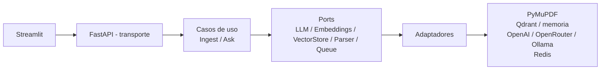

# Sistema RAG Multimodal

Sistema RAG para PDFs técnicos con texto, tablas, diagramas e imágenes.
Responde en lenguaje natural usando solo el contexto recuperado, muestra
la fuente con página y, cuando la respuesta usa un diagrama, muestra la
imagen más cercana.

> **Documento de ejemplo:** `examples/Manual_Motor.pdf` es un manual
> inventado para la prueba. No es un manual real de ningún fabricante.

## Arranque con un solo comando

```bash
cp .env.example .env   # opcional; sin llave, corre en modo demo sin costo
docker compose up --build
```

- API: http://localhost:8000 — docs en http://localhost:8000/docs
- Frontend: http://localhost:8501
- Qdrant: http://localhost:6333

Sin Docker, en local:

```bash
python -m venv .venv && source .venv/bin/activate
pip install -r requirements.txt
uvicorn app.main:app --reload          # API en :8000
streamlit run frontend/app.py          # UI en :8501
```

## Uso de la API

```bash
# 1. Ingerir (responde al instante con job_id, no bloquea)
curl -F "file=@examples/Manual_Motor.pdf" http://localhost:8000/ingest
# {"job_id": "...", "status": "pending", ...}

# 2. Consultar el progreso
curl http://localhost:8000/jobs/<job_id>
# status: pending | processing | completed | failed

# 3. Preguntar
curl -X POST http://localhost:8000/ask \
  -H "Content-Type: application/json" \
  -d '{"question": "¿Cuál es el par de apriete de los tornillos de culata?"}'
# {"answer": "... 24 Nm ...",
#  "sources": [{"document_name": "Manual_Motor.pdf", "page": 3, "kind": "table"}],
#  "image_url": "/images/<id>"}
```

Pregunta fuera de contexto → respuesta explícita, sin fuentes inventadas:

> "No tengo información suficiente en los documentos para responder eso."

## Arquitectura (hexagonal)



| Capa | Contenido |
|---|---|
| Transporte | `app/main.py` (FastAPI, solo HTTP) |
| Dominio | `app/domain/` — modelos, ports, chunking lógico, retrieval, casos de uso |
| Adaptadores | `app/adapters/` — PyMuPDF, embeddings, LLM, Qdrant/memoria, colas |
| Infraestructura | `app/infrastructure/` — retry, circuit breaker, logging |

El core no importa FastAPI, Streamlit ni ningún proveedor. Los casos de
uso solo conocen los `Protocol` de `app/domain/ports.py`.

## Decisiones técnicas

### Chunking por layout, no por caracteres
Se corta por sección (un encabezado abre sección nueva), las tablas son
un chunk propio (nunca se parten por la mitad) y dentro de una sección
larga se parte por párrafos con 120 caracteres de solapamiento. Cada
chunk guarda documento, página, bounding box y sección. Un corte solo por
caracteres rompería tablas y mezclaría secciones distintas, que es justo
lo que un manual técnico no permite.

### Multimodal con bounding boxes
PyMuPDF extrae texto con su rectángulo real, tablas con `find_tables`
(pdfplumber como respaldo) e imágenes raster con página y rectángulo.
Cada chunk de texto se asocia a la imagen más cercana en la misma página
(distancia entre centros de bbox). La UI muestra esa imagen junto a la
respuesta, no una imagen cualquiera del documento.

### Por qué PyMuPDF
PyMuPDF (fitz) da en una sola pasada texto con su rectángulo real,
tablas con `find_tables` e imágenes con página y rectángulo. Las
alternativas no dan eso junto: pypdf extrae texto pero sin layout ni
bounding boxes fiables, y pdfplumber da buenas tablas pero es más
lento y su modelo de layout es más limitado para diagramas. Por eso
pdfplumber queda solo como respaldo si PyMuPDF falla en un PDF. Sin
bounding boxes reales no habría chunking por layout ni "imagen más
cercana" fiable: esa es la base de lo multimodal.

### Recuperación híbrida
Semántica (coseno sobre embeddings) + BM25 implementado en el proyecto
(sin servicio externo). El puntaje final usa el coseno **crudo**, no
normalizado: si se normalizara, el mejor chunk siempre tendría 1.0
aunque la pregunta fuera totalmente ajena, y el umbral de relevancia
nunca rechazaría nada. El BM25 sí se normaliza porque su escala depende
del tamaño del corpus. Umbral de relevancia: 0.15; por debajo, negativa
explícita. Tanto BM25 como el embedding hash ignoran palabras vacías en
español ("de", "es", "la"...): sin eso, cualquier pregunta compartía
esos tokens con cualquier chunk y pasaba el umbral.

### Generación defensiva
Prompt de sistema con temperatura 0.0 que obliga a responder solo con el
contexto y a devolver la frase exacta de negativa si no alcanza. Nunca
se inventa fuente ni página: las fuentes salen de los chunks recuperados.

### Por qué Qdrant
Qdrant es el vectorial externo en producción (persistente, filtrable,
con API HTTP). En tests y demo se usa el adaptador en memoria con la
misma interfaz, para que los tests no necesiten Docker ni red. Cambiar
es `VECTOR_STORE=qdrant` en `.env`.

### Por qué Streamlit
Es el cliente más rápido de verificar para esta prueba (chat, Markdown,
imágenes, subida de PDF) sin un build de frontend. La API es
independiente: un cliente React/Next.js puede reemplazarlo sin tocar el
core.

### Cambiar de proveedor LLM
El adaptador es OpenAI-compatible (`/chat/completions`). Cambiar es
solo `.env`, sin tocar código:

| Proveedor | `OPENAI_BASE_URL` | Nota |
|---|---|---|
| OpenAI | `https://api.openai.com/v1` | `OPENAI_MODEL=gpt-4o-mini` |
| OpenRouter | `https://openrouter.ai/api/v1` | modelo OpenRouter, misma API |
| Ollama local | `http://localhost:11434/v1` | modelo local, sin costo por token |

Sin llave, o con `DEMO_MODE=true`, entra `FakeLLM`: respuesta
extractiva desde los chunks, sin llamar a ninguna API de pago. Es el
modo usado en tests y en la demo local.

### Tu propio token desde la web (opcional)
En la barra lateral, pega tu token y pulsa "Detectar proveedor": la API
lo prueba contra OpenAI y OpenRouter (en OpenRouter la validez se
comprueba con /auth/key porque /models es publico) y te muestra el
proveedor y sus modelos para elegir. Un token solo no dice que modelo
es: el modelo se lista desde el proveedor y lo eliges tu. Tambien hay
configuracion manual (proveedor + base_url + modelo) para cualquier
endpoint compatible con OpenAI, incluido Ollama local. Sin token, sigue
el modo demo sin costo. La clave solo vive en la memoria de tu sesion:
nunca se guarda en disco, en Git ni en logs, y viaja solo del navegador
al frontend por TLS y de ahi a la API por la red interna de Docker
(la API no se publica).

### Token guardable en el navegador (opcional)
Si pulsas "Guardar token en este navegador", el token se persiste SOLO
en el localStorage de tu navegador: nunca se guarda en el servidor, ni
en disco del backend, ni en Git, ni en logs. Al volver a cargar la
pagina, el campo se restaura y el proveedor se detecta automaticamente.
"Borrar token guardado" lo elimina de localStorage y de la sesion. Si el
navegador bloquea el almacenamiento, el flujo manual (pegar token +
Detectar) sigue funcionando. Nota honesta: localStorage lo puede leer
cualquier script del mismo origen; es el almacenamiento propio del
navegador del usuario, no un secreto compartido con el servidor.

### Modelo automatico: el mas economico (predeterminado)
Tras detectar el proveedor, la opcion predeterminada es "Automatico (el
mas economico)". Al preguntar, el backend elige segun lo que requiera
la pregunta: con imagen, el mas economico con vision; con audio, el
modelo de transcripcion; con solo texto, el chat mas economico. Para
elegir usa los precios que el proveedor devuelve en /models (OpenRouter
los trae) y, si no hay precios, una tabla de orden de costo conocido
(mini/flash primero) con fallback al orden del proveedor. Cada respuesta
muestra el modelo usado ("Modelo usado: gpt-4o-mini (automático)"). Si
eliges un modelo manual, se respeta tu eleccion.

### Preguntas por audio e imagen (chat, con token)
El chat acepta adjuntos (el PDF NO: sigue solo por la barra lateral):
- **Audio** (subido o grabado en el chat): `POST /ask-audio` lo
  transcribe con el endpoint /audio/transcriptions del proveedor de tu
  token (whisper-1 por defecto) y luego pregunta al RAG con el texto.
  La respuesta devuelve transcripcion + respuesta + fuentes. Sin token,
  la web avisa que el audio lo necesita y no se inventa ninguna
  transcripcion.
- **Imagen**: `POST /ask-image` la describe con el modelo de vision del
  proveedor (chat completions con image_url) y con esa descripcion busca
  en el RAG a que hace referencia. La respuesta devuelve descripcion +
  respuesta + fuentes + la imagen almacenada mas cercana. La imagen
  enviada NO se indexa como documento: es insumo de pregunta. Si el
  modelo no soporta vision, la API devuelve un error claro, sin
  descripcion inventada.

### Guardado inteligente de PDF (sin duplicar)
`POST /ingest` calcula el SHA-256 del archivo mientras lo escribe. Si el
mismo PDF ya fue ingerido, no duplica chunks: devuelve un job ya
completado que apunta al documento original, con el aviso "Documento ya
indexado" y `duplicate: true`. Si la ingesta anterior sigue en curso,
se devuelve ese mismo job para seguirlo por polling. Si fallo, el hash
se libera y un reintento vuelve a ingerir. El indice hash vive en
memoria por proceso, igual que el JobStore: tras un reinicio se
reconstruye con las ingestas nuevas.

### Responsive movil
El frontend usa `initial_sidebar_state="auto"` (barra colapsable en
celular) y CSS responsivo: en pantallas de hasta 768 px el chat va a
ancho completo, los botones son grandes y tactiles (minimo 48 px) y el
input usa fuente de 16 px para evitar el zoom automatico de iOS. No es
un rediseno completo, solo ajustes para que se vea bien en el movil.

### Embeddings
En producción: OpenAI / Ollama vía el mismo adaptador compatible. En
tests/demo: embedding por hash determinista (384 dim, offline, gratis).
No se recomienda el hash para producción: no entiende sinónimos ni
semántica real, solo coincidencia de tokens.

## Cómo escala a 100 manuales

1. **Ingesta asíncrona:** `POST /ingest` devuelve `job_id` al instante;
   el trabajo pesado corre en la cola, no en el hilo de la API. No hay
   timeouts por PDFs grandes.
2. **API sin estado:** el estado de jobs y los vectores viven fuera del
   proceso (Qdrant + JobStore externo en producción). Se pueden levantar
   varias réplicas de la API detrás de un balanceador.
3. **Vectorial externo:** Qdrant, no un índice en memoria, con
   colecciones por documento si hace falta aislamiento.
4. **Cola con workers:** la interfaz `JobQueuePort` ya existe; la
   implementación en memoria usa un pool de hilos y `RedisJobQueue`
   encola en Redis para que N workers consuman (`app/worker.py`).
   **Límite honesto actual:** el `JobStore` en memoria es por proceso;
   para multi-worker real hay que moverlo a una base de datos (Postgres)
   y compartir `storage/` por volumen u object store. Está documentado
   como siguiente paso, no fingido como hecho.
5. **Ingesta en lote:** subir 100 manuales son 100 jobs independientes;
   el progreso se consulta por `job_id` y un fallo no tumba los demás.

## Resiliencia

- Retry con exponential backoff + jitter solo en llamadas a proveedores
  (LLM, embeddings). Un PDF corrupto o una pregunta sin contexto no se
  reintentan.
- Circuit breaker (3 fallos → abierto 30 s) alrededor del LLM y los
  embeddings.
- Logging con `job_id` / `question_id` en ingesta y preguntas.

## Tests

```bash
pytest -q
```

Sin llave de API real y sin internet. Cubren: chunking por layout,
retrieval híbrido (BM25 + semántico), generación defensiva (sin
contexto → negativa explícita, fuera de contexto → negativa),
retry/circuit breaker, parser con bounding boxes e imágenes, y
endpoints (`/ingest`, `/jobs`, `/ask`) con la cola en memoria.

## Estructura

```
app/
  main.py                 # FastAPI (transporte)
  config.py               # pydantic-settings (.env)
  dependencies.py         # wiring: elige adaptadores segun .env
  domain/                 # modelos, ports, retrieval, casos de uso
  adapters/               # pdf_parser, chunking, embeddings, llm,
                          #   vector_store (memoria/Qdrant), queue
  infrastructure/         # resilience, logging
frontend/app.py           # Streamlit
examples/
  generate_manual.py      # genera el PDF de ejemplo
  Manual_Motor.pdf        # PDF de ejemplo (inventado para la prueba)
tests/                    # pytest con mocks, sin red ni llaves
docker-compose.yml        # api + frontend + qdrant + redis
```

## Sin N8N, a propósito

La prueba pide arquitectura limpia, DI y tests con mocks. Un flujo
visual escondería esa lógica y no se podría testear ni versionar igual.
La asincronía se resuelve con la cola del proyecto, no con un
orquestador externo.
